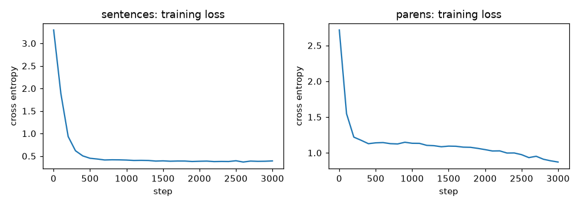

# lstm-numpy

A character-level LSTM with the forward pass and backprop-through-time
both written out by hand in NumPy. No autograd library anywhere: the
gradients for every gate are derived and coded directly, and the
gradient-check tests are what made that trustworthy.

## Results

Two synthetic corpora, 90 percent train and 10 percent held out, both
trained 3,000 steps (hidden size 96, batch 32, sequence length 48, Adam):

| corpus | LSTM NLL | 3-gram NLL |
|--------|----------|------------|
| sentences | 0.404 | 0.798 |
| parens    | 1.336 | 1.733 |

The more interesting number is on the parens corpus. Samples were scored
by whether the parentheses balance, which every training string
satisfies:

| sampler | balanced rate (200 samples) |
|---------|------------------------------|
| LSTM, temperature 0.8 | 0.975 |
| interpolated 3-gram   | 0.285 |

The n-gram cannot count, so it closes brackets at the rate a bigram view
of the data suggests. The LSTM closes 195 of 200, and its samples look
like well-formed arithmetic: `(((4+6)*(7*3))+5)`. On sentences it
learned word shapes and the plural agreement rule (`cats` takes `run`),
with the occasional overreach like `fishs sleep`.



## Layout

- src/lstm_numpy/lstm.py: the cell, forward and backward, gate by gate
- src/lstm_numpy/data.py: the two corpus generators
- src/lstm_numpy/train.py: Adam, gradient clipping, the training loop
- src/lstm_numpy/metrics.py: interpolated 3-gram baseline, sampling,
  the balanced-paren counter
- src/lstm_numpy/train_driver.py: trains both runs, writes results.json,
  weights and the loss curves

## Usage

```
pip install -e .
python -m lstm_numpy.train_driver
python -m pytest tests/
```

Four tests: a finite-difference gradient check over every gate weight,
a check that carried state across chunks matches one full pass, the
balanced-paren counter, and a loss-drops smoke test.
